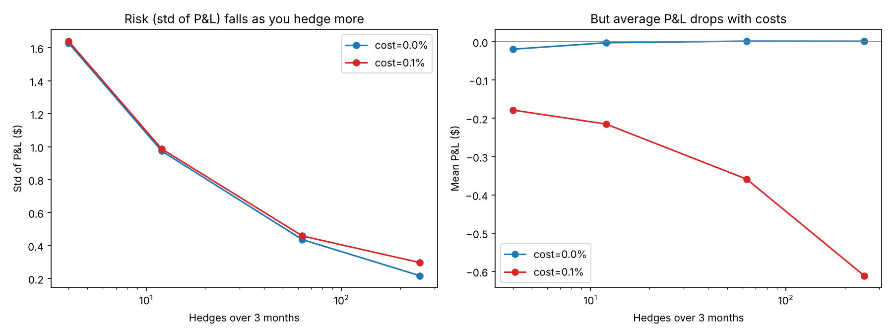
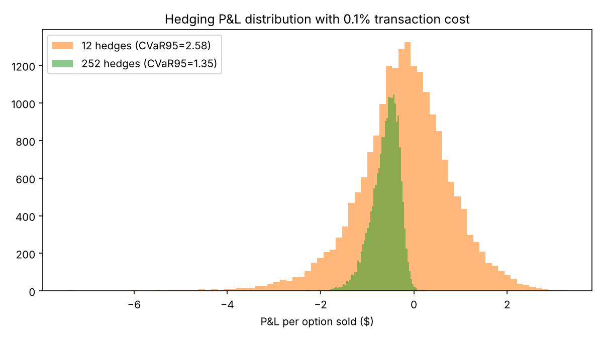

# Option Delta-Hedging Simulator

A Python Monte Carlo simulation showing how **hedging frequency** and **transaction costs** affect the risk and profit of an option seller.

## The setup
- Sell one 3-month at-the-money European call (spot $100, strike $100, vol 20%, rate 2%)
- Delta-hedge using the Black-Scholes delta at each rebalance date
- Simulate 20,000 stock price paths (geometric Brownian motion)
- Measure hedging P&L at expiry: mean, standard deviation, and 95% CVaR (average loss in the worst 5% of outcomes)

## Key results (20,000 paths, 0.1% transaction cost)
| Hedges over 3 months | Std of P&L, no cost | Std of P&L, with cost | Mean P&L, with cost | CVaR95, with cost |
|---|---|---|---|---|
| 4 | 1.63 | 1.64 | -0.18 | 4.13 |
| 12 (weekly) | 0.97 | 0.99 | -0.22 | 2.59 |
| 63 (daily) | 0.44 | 0.46 | -0.36 | 1.48 |
| 252 | 0.22 | 0.30 | -0.61 | 1.36 |

## Findings
1. **Without costs, risk shrinks roughly with the square root of hedge count.** Going from 12 to 252 hedges cuts P&L standard deviation by about 78%.
2. **With costs, hedging more has diminishing returns.** Average cost drag grows from $0.22 to $0.61 per option, and tail-risk improvement (CVaR) flattens between 63 and 252 hedges (1.48 vs 1.36).
3. **There is an optimal hedging frequency** that balances risk reduction against trading costs. This is the problem deep hedging (neural-network approaches) tries to solve better.
4. 

## Run it
`pip install numpy scipy matplotlib`, then `python hedge.py`. Or open `delta_hedging.ipynb` in Google Colab.

## Limitations
Constant volatility (no smile or stochastic vol), proportional costs only, no market impact, single option. Natural next step: Heston dynamics and a neural-network hedger trained on CVaR.
